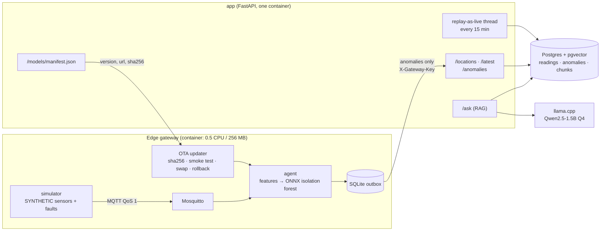

# Dhaka Air Quality — Edge AI + RAG assistant

**Two connected pieces, each measured.** An **edge gateway** scores a stream of air-quality sensor readings with an ONNX model on half a CPU, forwards only anomalies, survives uplink outages, and updates its model over the air. A **grounded assistant**, a local 1.5B LLM with retrieval, answers "is it safe to jog in Mirpur?" from the latest reading plus cited public health guidance. One small FastAPI app and one Postgres tie them together, all in docker compose.

Python · ONNX Runtime · scikit-learn · MQTT (Mosquitto) · SQLite · FastAPI · PostgreSQL + pgvector · llama.cpp · Qwen2.5-1.5B · bge-small embeddings · Docker Compose · GitHub Actions

> **Data honesty.**
> - There is no live data source. The app **replays historical Dhaka data as live** (same hour, two years earlier), labelled `source: replay-mendeley` everywhere.
> - That dataset (Mendeley doi:10.17632/9j447cynb9.1, CC BY 4.0) is almost certainly **modelled, not measured**: its columns match Open-Meteo's CAMS-based air-quality API, and Dhaka's series has no missing hour in 25 years. This is an inference, and we say so.
> - **Sensors and their faults are SYNTHETIC.** The simulator replays that data as 8 virtual sensors and injects faults with exact labels (stuck, spike, drift, dropout).
> - The assistant is a demo, **not medical advice**. Guidance text is fetched at ingest (US EPA, AirNow, WHO) and never committed; licences are recorded but unverified.

---

## Results (measured 2026-10-10, full tables and methods in [BENCHMARKS.md](BENCHMARKS.md))

**Edge anomaly detection** (2025 test year, 224 injected faults on 8 sensor series):

| Detector | Precision | Recall | F1 | Notes |
|---|---|---|---|---|
| Rules baseline | 0.33 | 0.90 | 0.48 | 478 false-alarm episodes |
| **Isolation forest (shipped, ONNX)** | **0.90** | **0.75** | **0.82** | stuck 93%, spike 95%, dropout 100%, **drift 9%** |

**Gateway end to end** (0.5 CPU, 256 MB container, 16,000 SYNTHETIC readings at 100/s): **97.2% bandwidth saved** (209 events forwarded). Precision 1.00 / recall 0.72 on what it actually sent. A 20 s uplink outage queued 32 events (max 31.6 s), and **none were lost**. The model was swapped over the air **mid-stream** (v1 → v2, re-publishing the same weights) from a manifest, with checksum and smoke test.

**Throughput at the edge** (SYNTHETIC, same 0.5 CPU / 256 MB gateway): **250 messages/s sustained** with no loss and p95 latency **3.3 ms**. Capacity is about **445 messages/s**, limited by CPU. Above that, the broker's queue fills and messages are dropped, so we know where the limit is and why.

**Retrieval** (32 labelled questions, k = 5): recall@5 **0.91**, MRR **0.80**. The CI gate **failed** a worse chunking (0.81 / 0.70).

**Assistant** (Qwen2.5-1.5B Q4_K_M, 2 CPU threads): 8/8 in-scope questions answered with citations, 4/4 off-topic refused, 90.5% of answer sentences supported by a source. Time to first token p50 **8.1 s**, **18.3 tokens/s**.

## Architecture



**How an answer is built** (ADR 0007):
1. A relevance gate refuses off-topic questions without calling the LLM.
2. The place is resolved to the nearest monitored location.
3. The latest PM2.5 comes from the `readings` table.
4. **Code** writes the facts sentence: value, place, age and US EPA category.
5. The advice row for that category, parsed from the AirNow guide, becomes source [1], followed by the retrieved chunks.
6. The model writes 2–3 sentences of advice.
7. Citations are **attributed by embedding similarity**, and unsupported sentences are flagged.

**How a model update reaches the gateway** (ADR 0009):
1. `scripts/publish_model.py` copies the model to `models/published/vN/` and rewrites `manifest.json` atomically.
2. The gateway polls the manifest and downloads the new file.
3. It checks the sha256, smoke-tests the model on a fixed sample, swaps directories with `rename()`, and rolls back if the reload fails.

## Run it

You need Docker and [uv](https://docs.astral.sh/uv/). Everything runs on one machine (`docs/DEPLOY.md` covers a single VM).

```bash
make setup data train        # deps; Dhaka replay data (303 MB download → 17 MB kept); train + export ONNX
make llm-model               # 1.1 GB GGUF into data/llm/
make up                      # postgres, app :8000 (/docs), llm, mosquitto, edge agent
make ingest                  # corpus → chunks → embeddings → pgvector
curl -X POST localhost:8000/ask -H 'content-type: application/json' -d '{"question":"Is it safe to jog in Mirpur this evening?"}'
make demo                    # SYNTHETIC sensors, uplink outage, OTA swap mid-stream → report
make bench                   # throughput of the edge path at 250…4,000 messages/s
make eval answers            # retrieval gate; answer-level check of /ask
make test                    # 18 tests (starts the compose Postgres)
```

The six containers are `postgres`, `app`, `llm`, `mosquitto`, `agent`, and `simulator`. The simulator is one-shot (profile `sim`).

## What is tested and gated

- **Tests** (18, against a real Postgres): feature parity between training and the gateway, fault injection, rules, outbox survival across restarts, agent dedupe/dropout/forwarding, OTA through the app's real manifest endpoint (publish script, swap, checksum rejection, broken model, rollback), readings idempotency and replay-as-live end to end, API endpoints (latest with age/stale, 401 without the key, idempotent anomaly POST), place resolution and AQI category, chunker (no duplicated or cut lines).
- **CI** (`.github/workflows/`): `ci.yml` runs lint, then tests with a pgvector service, plus a model job that retrains on pinned data and fails if isolation-forest F1 < 0.78 or precision < 0.85. `rag-eval.yml` is the retrieval gate: recall@5 and MRR must stay within 0.05 of the baseline. *The workflows have not run on GitHub yet.*
- **Not deployed anywhere.** Everything ran locally on 2026-10-10.

## Decisions

[`docs/adr/`](docs/adr/) covers:
- replay-as-live
- isolation forest on the edge (and why INT8 did not help)
- peer-deviation features
- MQTT QoS 1 + store-and-forward
- grounding a small LLM
- trim for defensibility (0009)

Superseded ADRs (MongoDB, MLflow OTA, Lambda images) are kept for history.

**History.** An earlier version also had serverless ingestion on AWS (Lambda, S3 Parquet, MongoDB time-series, Django Ninja), OTA from an MLflow registry, a Helm chart on k3d and an INT8 autoencoder study. It was trimmed so that every line can be explained (ADR 0009). The INT8 study's result was measured before the trim: INT8 made the tiny autoencoder **bigger (2.6 → 4.8 KB) and slower (8.7 → 11.6 µs)**, because quantisation overhead outweighs the savings on a ~300-weight model. The isolation forest has no MatMul at all, so INT8 never applied to it.

## Open problems

- **Slow drift** is detected only 9% of the time. It needs longer windows or seasonal baselines.
- **The gateway has little CPU headroom at 250 messages/s.** Mosquitto drops messages for a slow subscriber once 1,000 are queued. A real device needs either a rate limit or a larger, bounded queue.
- **Table-heavy PDF content** retrieves poorly (the breakpoint questions miss).
- **The relevance gate's margin is thin** (0.499 vs 0.492).
- The eval set is a first draft of 32 questions. It needs a second review and extension to 50–100 questions.
- No real arm64 device timings. No live data source. No Bangla answers.

## Author

Built by **Juthy**, B.Sc. (Hons.) in Information and Communication Technology, Institute of Information Technology, Jahangirnagar University.
